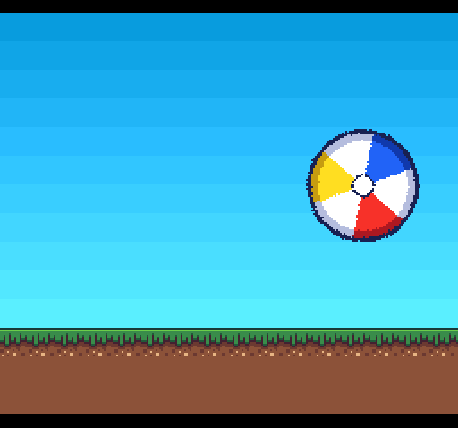

# mode7kit beach ball example



A beach ball spins and bounces across a grass floor, with `static.r65`:
`M7Static` moving one object rather than a view. The ball is the whole Mode 7
layer, rotated for the spin and scaled on the screen axes for the squash.
Everything past its edge is transparent and shows the sky, a COLDATA gradient
on the backdrop. The floor is 48 sprites in front of it, built from the
r65docs platformer's tiles.

- **A** kicks the ball up.
- **D-pad** left/right pushes it.
- **Start** pauses it.

```bash
make             # convert assets/ball.bmp with r65x bmp2chr, then build build/BEACHBALL.smc
pytest tests     # drive the ROM in Mesen-GDB (pip install -e Mesen-GDB/python)
```

The Makefile turns `assets/ball.bmp` (64×64, 8-bit indexed, index 0
transparent) into Mode 7 tiles and a palette with
`r65x bmp2chr -m7 -p -f`, writing `build/ball.chr` and `build/ball.pal`.
The ROM builds the Mode 7 map itself. Edit the bitmap and `make` rebuilds the
ROM from it.

The tests pause the ball and write its position, spin and zoom into `BALL`,
then check:
- `M7Static`'s matrix and scroll against the same formulas in Python;
- the ball's on-screen box, squash included;
- that past its edge the screen shows exactly the sky of each line;
- that the floor is the platformer's tiles in its palette, unchanged while the
  ball moves.

Unpaused, they check that the ball keeps bouncing, squashing with its bottom on
the floor, and rolling the way it moves, that a kick past the top of the screen
comes back down to land normally, and that the buttons work.

See [DESIGN.md](DESIGN.md) for the layout, the motion and the asset pipeline.

## Assets

- `assets/ball.bmp`: the beach ball, drawn for this example.
- `assets/platform.chr` and `assets/platform.pal`: the r65docs platformer
  example's tiles and palette, unchanged.
