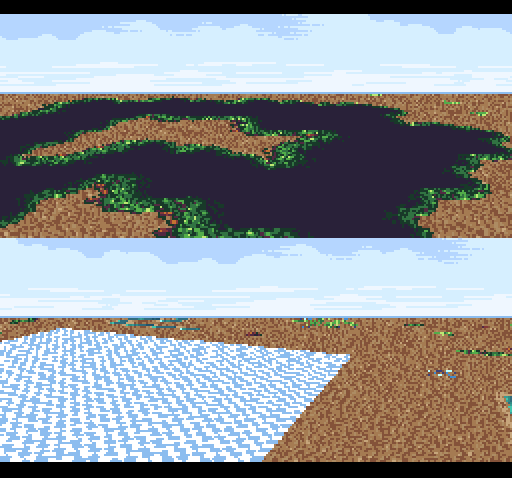

# mode7kit split example



Two perspective floors on one screen, each following its own camera, as in
a two-player racer: this example's own `m7k_split!` (`src/split.r65`) over
two mode7kit floor instances, with per-line bands of its own
(`src/bands.r65`). mode7kit has no bands or split screen of its own; see
[How the split is built](#how-the-split-is-built).

- The default floor `M7Plain` follows the example's `CAMERA` in the top half; a
  second instance, `FloorB` (`m7k_plain!`), follows `CAM_B`
  (`FloorB::set_camera(&CAM_B)`) in the bottom.
- `Bands4` (`m7k_bands!`, four bands, no COLDATA) gives each half a Mode 1
  sky band over its Mode 7 floor.
- `M7Views` sets each band's Mode 7 center and BG1 scroll by HDMA. The sky
  is BG1 in Mode 1, so each half's sky scrolls with its own camera.

**Pad 1:** the D-pad turns (left/right) and flies (up/down) the top
camera; Y/A turn and X/B fly the bottom one. Both look down a little
(`set_pitch(-24)`), since a half shows the top of a full-screen floor.

```bash
make             # fetch dependencies (mode7kit by path, stdlib from git) and build build/SPLIT.smc
pytest tests     # drive the ROM in Mesen-GDB (pip install -e Mesen-GDB/python)
```

The tests write the cameras and check, a half at a time by screenshot,
that each half follows its own camera and leaves the other alone, and that
both cameras in one place give the same sky and, but for Mode 7's
sub-texel rounding, the same floor. They check the channels in HDMAEN and
the floors' horizons, the bands' and the views' tables.

## How the split is built

`src/bands.r65` and `src/split.r65` are this example's code, not
mode7kit's. They build on its transport (the double buffer and segments,
the HDMAEN shadow) and on two floors through `Mode7Scan`: each built into
its half with `build(top, lines)`, its region `band()` placing the
half's sky band.

### `src/bands.r65`: per-line BG mode and layers

`m7k_bands!` writes a bands type: the screen as up to `max` runs of lines,
each with its own BGMODE and TM, and optionally a 16-line haze ramp at the
top of one band. Its tables are double-buffered with a transport and shown
with its front buffer (`show(k)`, `front_index()`).

| Channel | Register | Table | Mode |
|---|---|---|---|
| `ch_mode` | BGMODE $2105 | `bgm`, `max·4 + 1` bytes a buffer | direct, once: (lines, mode) per band |
| `ch_tm` | TM $212C | `tmt`, the same | direct, once: (lines, tm) per band |
| `ch_col` | COLDATA $2132 | `col`, `max·6 + 4` bytes a buffer | indirect: black over each band, the ramp a byte a line, black |

COLDATA is indirect, reading a 17-byte copy of black and the ramp
(`M7K_FADE[0]`, `[17..33]`) that `setup` puts in the bands' state: a fill
writes three entries instead of the 16 ramp bytes. `M7K_FADE: [u8; 33]` is
dizworld's `build_fade_table`.

| Function | Does |
|---|---|
| `set_count(n)`, `set_band(i, lines, mode, tm)`, `set_lines(i, lines)` | The layout: `mode` is sneslib's `BG`, `tm` the TM byte. The last band takes the rest of the screen, whatever its `lines`. A change bumps the version. |
| `set_haze(i)` | The ramp at the top of band i (`M7K_NO_HAZE`: none); needs a COLDATA channel. Before `setup`. |
| `setup()` | The channels on buffer 0, both buffers filled; with a haze, the ramp's copy, CGWSEL = 0 and CGADSUB = add on BG1; the channels in the transport's shadow |
| `stop()` | The channels out of the shadow. BGMODE, TM and COLDATA keep the last values their tables wrote. |
| `fill_back()`, `fill(k)` | The back buffer's tables, skipped when its key matches the version; buffer k's, always |
| `show(k)` | Points the channels at buffer k |
| `back_index()`, `front_index()` | The transport's buffer being built, and the one on screen after its `commit()` |

The tables are written in place with direct stores (`m7k_band_hold!`,
`m7k_band_ind!`), not the far-pointer table writers.

### `src/split.r65`: views and the split screen

`m7k_views!` writes a views type: per band, the Mode 7 center and the BG1
scroll, by direct HDMA, double-buffered and shown like the bands.

| Channel | Registers | Table |
|---|---|---|
| `ch_center` | M7X/M7Y (BBAD $1F, DMAP 3: two write-twice registers) | `ctr`: (lines, cx, cy) per view, `max·10 + 1` bytes a buffer |
| `ch_scroll` | BG1HOFS/BG1VOFS (BBAD $0D, DMAP 3) | `scr`: (lines, hofs, vofs) per view |

`set_count(n)`, `set_view(i, lines, cx, cy, hofs, vofs)`, `setup()`,
`stop()`, `fill_back()`, `fill(k)` and `show(k)` work as the bands' do.
A view over 127 lines takes two entries.

`m7k_split!` writes a preset implementing `Mode7`: floor A over lines
0..half (112 by default) and floor B under it, each following its own
camera, each half a sky band and a floor band.

- `update()` builds A with `build(0, half)` and B with `build(half, 224 −
  half)`, sets the four bands' lines at the two horizons, sets four views,
  and finishes one frame of four segments: A's top matrix, A's rows from
  row 0, B's top matrix, B's rows from row `half`.
- **The sky is BG1.** The views write BG1's scroll at each band, and in
  Mode 1 that is the sky layer's scroll, so each half's sky band gets its
  own: parallax from its floor's heading, and the bottom of a 240-line sky
  on its horizon. No channel more; the game points BG1SC and BG12NBA at
  the sky, which Mode 7 ignores.
- The `Mode7` projections answer for floor A; `FloorB::to_screen` answers
  for the bottom half, its sy already offset by the band.
- **The halves can't match pixel for pixel.** Mode 7 truncates its
  y-term (B·y, D·y) and its (VOFS − CY)-term to 1/64 separately. A view
  112 lines lower has y 112 more and VOFS 112 less, the same sum split
  differently, so with both cameras in one place about 1 pixel in 15 of
  the floors rounds the other way. The skies match exactly.

## Assets

The graphics are the flyer example's dizworld assets, read from
`../flyer/assets/`; see that example's README for the credits.
